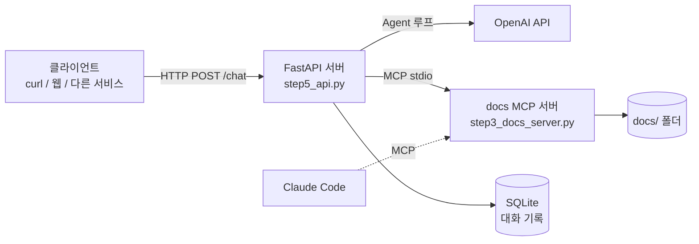

# Docs Agent: LLM Agent를 밑바닥부터 서비스까지

프레임워크(LangChain 등) 없이 **LLM 호출 → Tool Calling → MCP → Web API → DB → Docker** 순서로
문서 조회 Agent를 단계별로 직접 구현한 학습 프로젝트입니다.
각 단계는 독립 실행 가능한 파일로 남겨 두어, Agent 시스템이 어떤 층으로 이루어지는지 따라가며 볼 수 있습니다.

## 구조



- **Agent 루프**: LLM이 도구를 고르면 서버가 실행하고, 결과를 대화 기록에 넣어 다시 LLM을 호출합니다. 최대 단계 수로 무한 루프를 막습니다.
- **도구 분리(MCP)**: 도구는 별도 MCP 서버에 있습니다. Agent는 시작할 때 `list_tools`로 도구를 발견하므로, 서버에 도구를 추가해도 Agent 코드는 바뀌지 않습니다. 같은 서버를 Claude Code에도 연결해 사용했습니다.
- **세션과 저장소**: `session_id`로 사용자별 대화를 구분하고, 저장소 계층(`db.py`)을 통해 SQLite에 저장합니다. 서버나 컨테이너를 재시작해도 대화가 유지됩니다.

## 단계별 구현

| 단계 | 파일 | 내용 |
|---|---|---|
| 1 | `step1_hello.py`, `step1_chat.py` | LLM 단일 호출과 멀티턴 대화. LLM은 상태가 없고 `messages`가 곧 상태임을 확인 |
| 2 | `step2_tools.py` | Tool Calling Agent 루프, 도구 실행 오류 처리, 파일 접근 범위 제한 |
| 3 | `step3_docs_server.py`, `step3_client.py`, `step3_agent.py` | 도구를 MCP 서버로 분리하고, MCP 클라이언트로 도구를 발견하고 호출 |
| 4 | `step4_api.py` | FastAPI로 Agent를 HTTP API화. Pydantic 입력 검증, 세션, async 처리 |
| 5 | `db.py`, `step5_api.py`, `step5_db_basics.py` | SQLite 저장소 계층, 증분 저장(새 메시지만 저장) |
| 6 | `Dockerfile`, `requirements.txt` | 컨테이너화, 비밀정보 런타임 주입, 볼륨으로 데이터 영속화 |

## 보안 관련 결정

- **경로 탐색 방어**: `read_file`은 `realpath` + `commonpath`로 실제 경로를 계산해 `docs/` 밖 접근(`../.env`, `/etc/passwd`, 심볼릭 링크)을 차단합니다.
  LLM이 스스로 거절하는 것에 의존하지 않고, 도구 코드에서 막습니다.
- **SQL 인젝션 방어**: 모든 쿼리는 `?` 파라미터 바인딩을 사용합니다.
- **비밀정보 분리**: API 키는 `.env`로만 관리하며 Git과 Docker 이미지 모두에서 제외합니다(`.gitignore`, `.dockerignore`). 컨테이너에는 `--env-file`로 주입합니다.
- **도구 오류 격리**: 도구 실행 예외는 서버를 중단시키지 않고, 오류 메시지를 tool 결과로 LLM에 돌려줍니다.

## 실행 방법

```bash
cd week1
cp .env.example .env   # OPENAI_API_KEY 입력
```

**로컬 (Python 3.11)**

```bash
pip install -r requirements.txt
uvicorn step5_api:app --port 8000
```

**Docker**

```bash
docker build -t docs-agent .
mkdir -p data
docker run -d --name docs-agent --env-file .env -p 8000:8000 -v "$(pwd)/data:/data" docs-agent
```

**사용 예**

```bash
curl -s -X POST localhost:8000/chat -H 'Content-Type: application/json' \
  -d '{"message": "docs에 어떤 문서가 있는지 보고 MCP 문서를 요약해줘"}'
# 응답의 session_id를 다음 요청에 넣으면 대화가 이어집니다
```

API 문서는 서버 실행 후 `http://localhost:8000/docs`에서 볼 수 있습니다.

| 엔드포인트 | 설명 |
|---|---|
| `POST /chat` | 메시지 전송. `session_id`가 없으면 새 세션 생성. 답변과 도구 호출 기록 반환 |
| `GET /sessions/{session_id}` | 세션의 전체 대화 기록 조회 (없으면 404) |
| `GET /health` | 상태 확인 |

## 앞으로 할 것

- [ ] pytest: 경로 검사, 저장소, LLM 응답을 모킹한 Agent 루프 테스트
- [ ] Agent 평가: 질의 세트에 대한 도구 선택 정확도, 답변 정확도, 지연시간, 비용 측정
- [ ] 인증: 세션 소유권 검사 (현재는 `session_id`만 알면 대화 조회 가능)
- [ ] 컨테이너를 root가 아닌 일반 사용자로 실행
