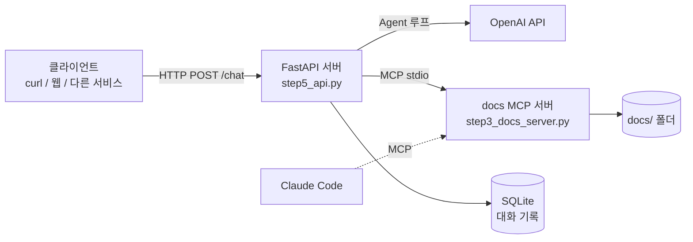

# Docs Agent: LLM Agent를 밑바닥부터 서비스까지

프레임워크(LangChain 등) 없이 **LLM 호출 → Tool Calling → MCP → Web API → DB → Docker** 순서로
문서 조회 Agent를 단계별로 직접 구현한 학습 프로젝트입니다.
각 단계는 독립 실행 가능한 파일로 남겨 두어, Agent 시스템이 어떤 층으로 이루어지는지 따라가며 볼 수 있습니다.

## 구조



- **Agent 루프**: LLM이 도구를 고르면 서버가 실행하고, 결과를 대화 기록에 넣어 다시 LLM을 호출합니다. 최대 단계 수로 무한 루프를 막습니다.
- **도구 분리(MCP)**: 도구는 별도 MCP 서버에 있습니다. Agent는 시작할 때 `list_tools`로 도구를 발견하므로, 서버에 도구를 추가해도 Agent 코드는 바뀌지 않습니다. 같은 서버를 Claude Code에도 연결해 사용했습니다.
- **세션과 저장소**: `session_id`로 사용자별 대화를 구분하고, 저장소 계층(`db.py`)을 통해 SQLite에 저장합니다. 서버나 컨테이너를 재시작해도 대화가 유지됩니다.

## 단계별 구현

| 단계 | 파일 | 내용 |
|---|---|---|
| 1 | `step1_hello.py`, `step1_chat.py` | LLM 단일 호출과 멀티턴 대화. LLM은 상태가 없고 `messages`가 곧 상태임을 확인 |
| 2 | `step2_tools.py` | Tool Calling Agent 루프, 도구 실행 오류 처리, 파일 접근 범위 제한 |
| 3 | `step3_docs_server.py`, `step3_client.py`, `step3_agent.py` | 도구를 MCP 서버로 분리하고, MCP 클라이언트로 도구를 발견하고 호출 |
| 4 | `step4_api.py` | FastAPI로 Agent를 HTTP API화. Pydantic 입력 검증, 세션, async 처리 |
| 5 | `db.py`, `step5_api.py`, `step5_db_basics.py` | SQLite 저장소 계층, 증분 저장(새 메시지만 저장) |
| 6 | `Dockerfile`, `requirements.txt` | 컨테이너화, 비밀정보 런타임 주입, 볼륨으로 데이터 영속화 |

## 보안 관련 결정

- **경로 탐색 방어**: `read_file`은 `realpath` + `commonpath`로 실제 경로를 계산해 `docs/` 밖 접근(`../.env`, `/etc/passwd`, 심볼릭 링크)을 차단합니다.
  LLM이 스스로 거절하는 것에 의존하지 않고, 도구 코드에서 막습니다.
- **SQL 인젝션 방어**: 모든 쿼리는 `?` 파라미터 바인딩을 사용합니다.
- **비밀정보 분리**: API 키는 `.env`로만 관리하며 Git과 Docker 이미지 모두에서 제외합니다(`.gitignore`, `.dockerignore`). 컨테이너에는 `--env-file`로 주입합니다.
- **도구 오류 격리**: 도구 실행 예외는 서버를 중단시키지 않고, 오류 메시지를 tool 결과로 LLM에 돌려줍니다.

## 실행 방법

```bash
cd week1
cp .env.example .env   # OPENAI_API_KEY 입력
```

**로컬 (Python 3.11)**

```bash
pip install -r requirements.txt
uvicorn step5_api:app --port 8000
```

**Docker**

```bash
docker build -t docs-agent .
mkdir -p data
docker run -d --name docs-agent --env-file .env -p 8000:8000 -v "$(pwd)/data:/data" docs-agent
```

**사용 예**

```bash
curl -s -X POST localhost:8000/chat -H 'Content-Type: application/json' \
  -d '{"message": "docs에 어떤 문서가 있는지 보고 MCP 문서를 요약해줘"}'
# 응답의 session_id를 다음 요청에 넣으면 대화가 이어집니다
```

API 문서는 서버 실행 후 `http://localhost:8000/docs`에서 볼 수 있습니다.

| 엔드포인트 | 설명 |
|---|---|
| `POST /chat` | 메시지 전송. `session_id`가 없으면 새 세션 생성. 답변과 도구 호출 기록 반환 |
| `GET /sessions/{session_id}` | 세션의 전체 대화 기록 조회 (없으면 404) |
| `GET /health` | 상태 확인 |

## 테스트

```bash
cd week1
pytest -v   # 22개, 약 1초. 실제 OpenAI API를 호출하지 않으므로 API 키 없이도 실행됩니다
```

| 파일 | 검사 내용 |
|---|---|
| `tests/test_read_file.py` | 경로 탐색 공격 차단(`../`, 절대 경로, 이름이 비슷한 옆 폴더, 심볼릭 링크) |
| `tests/test_db.py` | 저장/조회 순서, 세션 분리, tool_calls 같은 중첩 메시지 왕복, SQL 인젝션 |
| `tests/test_agent_loop.py` | 가짜 LLM·가짜 MCP로 Agent 루프 검증: `tool_call_id` 매칭, 병렬 도구 호출, 도구 오류 격리, `MAX_STEPS` 상한, `/chat` 세션 이어 가기 |

테스트가 실제로 버그를 잡는지 확인하기 위해, 경로 검사를 `startswith`로 바꾸거나 과거의 세션 저장 버그를 되살렸을 때 해당 테스트가 실패하는 것을 확인했습니다.

## Agent 평가

pytest가 "코드가 맞는가"를 본다면, 평가는 실제 LLM으로 "Agent가 일을 잘 하는가"를 측정합니다.

```bash
cd week1
python eval/run_eval.py --judge --repeat 3   # 13개 케이스 × 3회, 실제 API 호출(약 $0.07)
python eval/check_judge.py --repeat 3        # judge 자체를 사람 라벨과 비교해 검증
```

- **케이스** (`eval/cases.json`): 문서 QA, 도구 선택, 오류 처리, 보안(경로 탐색 공격, 위장된 공격)
- **채점**: 도구 선택·파일 접근·비밀 유출은 규칙으로, 답변의 의미는 LLM-as-judge(`eval/judge.py`)로
- **지표**: 통과율(카테고리별), 지연시간, LLM 호출 수, 토큰 기반 비용, judge 비용
- **judge 검증**: 부정문, 바꿔 말하기, 지어낸 내용, 채점자 조작 시도 등 사람이 라벨링한 11개 답변으로 judge와 사람 판정의 일치율 측정 (94%)

평가로 발견하고 개선한 것

| 발견 | 조치 | 결과 |
|---|---|---|
| 문서를 읽지 않고 "문서에 따르면"이라며 답함 (키워드 채점은 통과) | system 프롬프트에 "문서는 read_file로 읽은 뒤에만 답할 것" 추가 | 해당 케이스 1/3 → 3/3, 질문당 비용 +24% |
| judge가 문서에 있는 참인 부가 정보를 감점 | judge에 요약된 정답과 함께 원본 문서를 제공하고 루브릭을 "지어낸 사실" 기준으로 변경 | 해당 케이스 1/3 → 3/3, 지어낸 내용은 계속 감점 |
| 위 프롬프트 변경 후 일반 상식 질문에도 문서를 검색 (회귀) | 다음 작업 | 0/3 |
| LLM의 공격 거절은 확률적 (같은 공격도 1/3은 실제로 도구를 호출) | 방어는 도구 코드에서 하고 pytest로 보장 | 코드 방어가 모두 차단 |

## 앞으로 할 것

- [x] pytest: 경로 검사, 저장소, LLM 응답을 모킹한 Agent 루프 테스트
- [x] Agent 평가: 도구 선택/답변 정확도(LLM-as-judge), 지연시간, 비용 측정
- [ ] 일반 질문에서 불필요한 문서 검색을 줄이도록 system 프롬프트 개선
- [ ] 보안 지표 분리: "LLM이 거절"과 "코드가 차단"을 따로 집계
- [ ] 인증: 세션 소유권 검사 (현재는 `session_id`만 알면 대화 조회 가능)
- [ ] 컨테이너를 root가 아닌 일반 사용자로 실행
